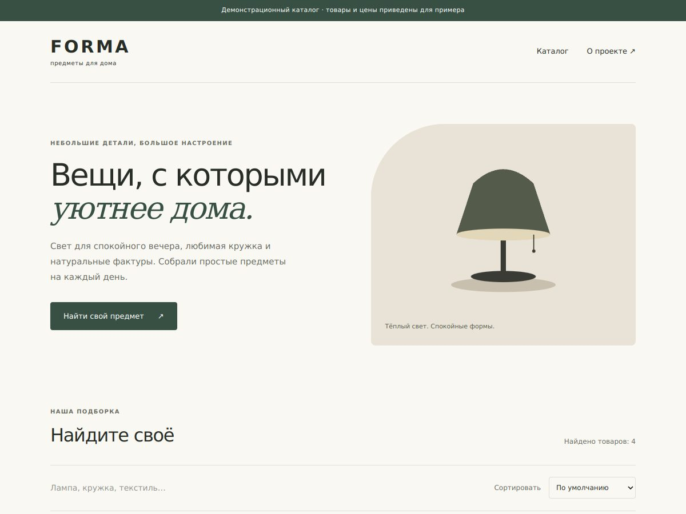

# FORMA - каталог товаров

Демонстрационный каталог предметов для дома на Next.js и TypeScript. Проект показывает путь от поиска и выбора товара до подготовки заявки.



## Возможности

- Поиск по названию, описанию и категории.
- Фильтрация по категориям и сортировка по цене.
- Отдельные страницы товаров со своими заголовками и описаниями для поиска.
- Форма заявки с автоматическим заполнением товара и цены в письме.
- Адаптивная вёрстка, работа с клавиатуры и статическая публикация.
- Локальные SVG-иллюстрации: каталог не зависит от фотохостингов и загрузки Google Fonts.

## Запуск

```bash
cd storefront
npm ci
npm run dev
```

Откройте http://localhost:3000. Проверка: `npm run lint` и `npm run build`.

## Публикация на GitHub Pages

В Settings → Pages выберите источник **GitHub Actions**. Workflow `pages.yml` собирает каталог после обновления `main`. Путь `/Showcase` настраивается через `NEXT_PUBLIC_BASE_PATH`, статические файлы появляются в `storefront/out`.

Для другого хостинга соберите с пустым `NEXT_PUBLIC_BASE_PATH`. Отдельный Node.js-сервер для готового сайта не требуется.

## Заявки и данные

Каталог учебный: товары, цены и иллюстрации служат примером. Форма открывает письмо автору проекта; пользователь подтверждает отправку в своём почтовом приложении. Это не магазин с оплатой и учётом заказов. Адрес получателя можно задать переменной сборки `NEXT_PUBLIC_CONTACT_EMAIL`.

Данные находятся в `storefront/src/data/products.ts`, иллюстрации - в `storefront/public/products/`.
